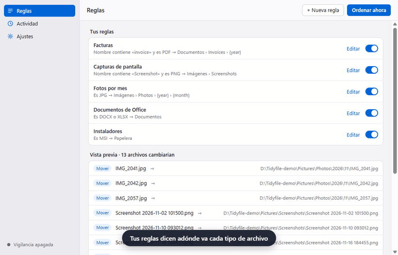

<h1 align="center">Tidyfile</h1>

<p align="center">
  <strong>Tus carpetas, ordenadas con reglas que puedes ver… y deshacer.</strong><br>
  Un organizador de archivos gratuito, de código abierto y multiplataforma, con una interfaz gráfica de verdad.
</p>

<p align="center">
  
  
  
  
</p>

<p align="center">
  <a href="README.md">English</a> · <strong>Español</strong>
</p>

<p align="center">
  
</p>

Define reglas visuales —*"si es un PDF y el nombre contiene 'factura', muévelo a Documentos/Facturas/2026"*— y Tidyfile mantiene tus carpetas en orden: cuando tú se lo pides, o solo, mientras las vigila. Todo funciona en tu equipo: sin nube, sin cuenta, sin telemetría y sin suscripción.

> **Estado: pre-lanzamiento.** La aplicación funciona de principio a fin —reglas, vista previa, ordenado, deshacer y vigilancia en tiempo real— y ha pasado muchas pruebas en Windows y Linux, pero todavía no ha pasado por una beta pública y no hay versiones publicadas. Si quieres probarla, compílala desde el código fuente.

## Cómo funciona

1. **Escribe una regla.** Elige condiciones (extensión, nombre, tamaño, antigüedad…) y acciones (mover, copiar, renombrar, enviar a la Papelera). Un ejemplo en vivo te enseña qué haría la regla con un archivo real antes de guardarla.
2. **Mira la vista previa.** Aparecen todos los archivos que cambiarían, con su destino. Todavía no se ha movido nada.
3. **Ordenar ahora… o deja que vigile.** Tidyfile hace exactamente lo que mostró la vista previa. Activa la vigilancia y los archivos nuevos se ordenan al llegar. Cada lote se puede deshacer desde Actividad.

## Tus archivos son el producto

Un organizador de archivos que pierde los archivos de alguien no vale nada, así que aquí la seguridad no es una función más: es el diseño.

- **Nunca se borra nada.** Lo que se elimina va a la papelera del sistema, y no hay borrado directo en ningún punto del código. En Windows, enviar un archivo a la Papelera —o deshacer una copia— se niega allí donde la Papelera no podría guardarlo: una carpeta de red, un pendrive, una unidad con la Papelera desactivada o un archivo más grande que ella. El archivo se queda donde está y la app te dice por qué. *Mover* un archivo desde una de esas unidades sí se hace: cuando la copia en el destino está verificada, el original se elimina para siempre y su contenido sigue en el destino.
- **Vista previa antes de mover nada.** La vista previa y la ejecución real comparten el mismo código, y *Ordenar ahora* se niega a actuar si tus carpetas cambiaron desde la vista previa.
- **Todo se puede deshacer.** Cada operación se escribe en un journal SQLite *antes* de tocar el disco. Un clic revierte un lote entero, incluidos los que se aplicaron solos mientras se vigilaba.
- **Nada se sobrescribe.** Si un nombre ya existe, se añade un número o se espera a que decidas. Nunca se reemplaza un archivo existente.
- **Las copias se verifican.** Una copia entre unidades se vuelca al disco y se comprueba antes de soltar el original. En Windows, un archivo que otro programa sigue escribiendo se deja en paz.
- **Los nombres hostiles se controlan.** Descargas a medias, enlaces que salen de la carpeta vigilada, nombres que Windows leería como otro archivo y trucos de derecha a izquierda en los nombres no pueden hacer daño.
- **Los bucles se frenan.** Si tus reglas se pasan un archivo de una carpeta vigilada a otra sin parar, la vigilancia deja de moverlo y te dice cuál es.

## Funciones

| | |
|---|---|
| **Editor visual de reglas** | Condiciones combinables (todas / alguna) y acciones, con un ejemplo en vivo. Sin YAML y sin regex obligatorias. |
| **Condiciones** | Extensión, el nombre contiene, glob, regex, tamaño, antigüedad, subcarpeta. |
| **Acciones** | Mover, copiar, renombrar con plantillas, enviar a la Papelera y subcarpetas automáticas por fecha. |
| **Plantillas** | `{name}`, `{ext}`, `{date}`, `{year}`, `{month}`, `{day}` y `{counter}`. |
| **Vigilancia en tiempo real** | Los archivos nuevos se ordenan al llegar; las descargas a medias se dejan quietas hasta que terminan. |
| **Actividad** | Cada lote, agrupado por día y con su origen, se puede deshacer entero o archivo a archivo. |
| **Dos idiomas** | Español e inglés, según el idioma de tu sistema o el que elijas. |
| **Claro y oscuro** | Sigue el tema de tu sistema y se lee bien incluso en ventanas pequeñas. |

## ¿Por qué otro organizador?

A todas las herramientas que existen les falta algo:

| | Precio | Multiplataforma | Interfaz gráfica | Código abierto | Mantenida |
|---|---|---|---|---|---|
| Hazel | 42 $ | Solo macOS | Sí | No | Sí |
| File Juggler | ~40 $ | Solo Windows | Sí | No | Sí |
| File Arbor | Freemium | Win / macOS | Sí | No | Sí |
| DropIt | Gratis | Solo Windows | Sí | Sí | Sin versiones desde 2018 |
| organize | Gratis | Sí | No — CLI + YAML | Sí | Sí |
| hazelnut | Gratis | Sí | No — interfaz de terminal | Sí | Sí |
| **Tidyfile** | **Gratis** | **Win / macOS / Linux** | **Sí** | **Sí** | **Sí** |

Ninguna otra marca todas las casillas, y ninguna otra ofrece una interfaz gráfica de verdad en Linux.

## Compilar desde el código fuente

Necesitas [Rust](https://rustup.rs) 1.90+ y [Node.js](https://nodejs.org) 22.17+, además de los [requisitos de Tauri](https://tauri.app/start/prerequisites/) para tu plataforma.

```bash
npm install
npm run tauri dev      # ejecutar en desarrollo
npm run tauri build    # generar los instaladores
```

## Versiones sin firmar

Las versiones publicadas no están firmadas digitalmente: un certificado de Apple cuesta 99 $ al año y uno de Windows más, algo que hoy no es sostenible para un proyecto gratuito.

Por eso macOS y Windows te avisarán la primera vez que abras la aplicación. Las sumas SHA-256 publicadas te permiten comprobar que lo que descargaste coincide con lo que compiló la integración continua. La firma puede llegar más adelante si el proyecto lo justifica.

## Licencia

[GNU General Public License v3.0](LICENSE).

Tidyfile existe porque las buenas herramientas de esta categoría son de pago y cerradas. La GPL garantiza lo contrario: cualquiera puede usarlo, estudiarlo, modificarlo y compartirlo, pero un derivado que se distribuya tiene que entregarse con su código fuente y bajo las mismas condiciones. Nadie puede cerrarlo y vendértelo de vuelta.
