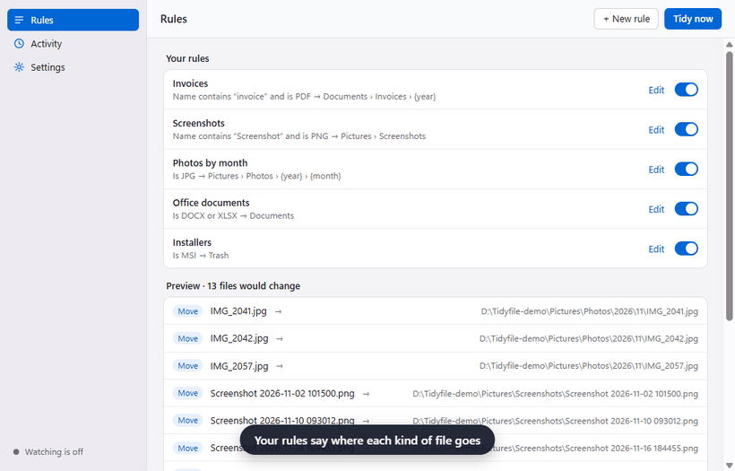

<h1 align="center">Tidyfile</h1>

<p align="center">
  <strong>Your folders, tidied by rules you can see — and undo.</strong><br>
  A free, open-source, cross-platform file organizer with a real graphical interface.
</p>

<p align="center">
  
  
  
  
</p>

<p align="center">
  <strong>English</strong> · <a href="README.es.md">Español</a>
</p>

<p align="center">
  
</p>

Define visual rules — *"if it's a PDF and the name contains 'invoice', move it to Documents/Invoices/2026"* — and Tidyfile keeps your folders in order, by hand or on its own while it watches them. Everything runs on your computer: no cloud, no account, no telemetry, no subscription.

> **Status: pre-release.** The app works end to end — rules, preview, tidying, undo and live watching — and has been through extensive testing on Windows and Linux, but it has not been through a public beta yet and there are no published releases. Build it from source if you want to try it.

## How it works

1. **Write a rule.** Pick conditions (extension, name, size, age…) and actions (move, copy, rename, send to the trash). A live example shows what the rule would do to a real file before you save it.
2. **Look at the preview.** Every file that would change is listed with its destination. Nothing has moved yet.
3. **Tidy now — or let it watch.** Tidyfile does exactly what the preview showed. Turn on watching and new files are tidied as they arrive. Every batch can be undone from Activity.

## Your files are the product

A file organizer that loses someone's files is worthless, so safety is not a feature here — it is the design.

- **Nothing is ever deleted.** Removals go to the system trash, and there is no direct delete anywhere in the codebase. On Windows, sending a file to the trash — or undoing a copy — is refused wherever the Recycle Bin could not keep it: a network share, a USB stick, a drive whose Recycle Bin is turned off, or a file bigger than the Recycle Bin. The file stays where it is and the app tells you why. A *move* away from such a drive does complete: once the copy at the destination has been verified, the original is removed for good, and its content lives on at the destination.
- **Preview before anything moves.** The preview and the real run share the same code, and *Tidy now* refuses to act if your folders changed since the preview.
- **Everything is undoable.** Each operation is written to a SQLite journal *before* the disk is touched. One click reverts a batch — including batches applied automatically while watching.
- **Nothing is overwritten.** A name collision gets a numbered suffix, or waits for your decision. Existing files are never replaced.
- **Copies are verified.** A copy between drives is flushed to disk and checked before the original is let go. On Windows, a file another program is still writing is left alone.
- **Hostile names are handled.** Unfinished downloads, links that point outside a watched folder, names Windows would read as a different file, and right-to-left tricks in file names are all kept from doing harm.
- **Loops are stopped.** If your rules keep moving a file back and forth between watched folders, watching stops moving it and tells you which file.

## Features

| | |
|---|---|
| **Visual rule editor** | Combinable conditions (all / any) and actions, with a live example. No YAML, no mandatory regex. |
| **Conditions** | Extension, name contains, glob, regex, size, age, subfolder. |
| **Actions** | Move, copy, rename with templates, send to trash, automatic subfolders by date. |
| **Templates** | `{name}`, `{ext}`, `{date}`, `{year}`, `{month}`, `{day}` and `{counter}`. |
| **Live watching** | New files are tidied as they arrive; partial downloads are left alone until they finish. |
| **Activity** | Every batch listed by day with where it came from, every batch undoable — whole or file by file. |
| **Two languages** | English and Spanish, following your system language or the one you pick. |
| **Light and dark** | Follows your system theme; readable down to small windows. |

## Why another file organizer?

Every existing tool misses something:

| | Price | Cross-platform | GUI | Open source | Maintained |
|---|---|---|---|---|---|
| Hazel | $42 | macOS only | Yes | No | Yes |
| File Juggler | ~$40 | Windows only | Yes | No | Yes |
| File Arbor | Freemium | Win / macOS | Yes | No | Yes |
| DropIt | Free | Windows only | Yes | Yes | No releases since 2018 |
| organize | Free | Yes | No — CLI + YAML | Yes | Yes |
| hazelnut | Free | Yes | No — terminal UI | Yes | Yes |
| **Tidyfile** | **Free** | **Win / macOS / Linux** | **Yes** | **Yes** | **Yes** |

Nothing else ticks every box, and nothing else offers a real graphical interface on Linux.

## Building from source

Requires [Rust](https://rustup.rs) 1.90+ and [Node.js](https://nodejs.org) 22.17+, plus the [Tauri prerequisites](https://tauri.app/start/prerequisites/) for your platform.

```bash
npm install
npm run tauri dev      # run in development
npm run tauri build    # produce installers
```

## Unsigned builds

Releases are not code-signed: an Apple certificate costs $99/year and a Windows one costs more, which is not sustainable for a free project right now.

This means macOS and Windows will warn you the first time you open the app. Published SHA-256 checksums let you verify that a download matches what CI built. Signing may come later if the project warrants it.

## License

[GNU General Public License v3.0](LICENSE).

Tidyfile exists because the good tools in this category are paid and closed. The GPL keeps it that way round: anyone may use, study, modify and share it, but a distributed derivative has to ship its source under the same terms. Nobody gets to close it and sell it back to you.
